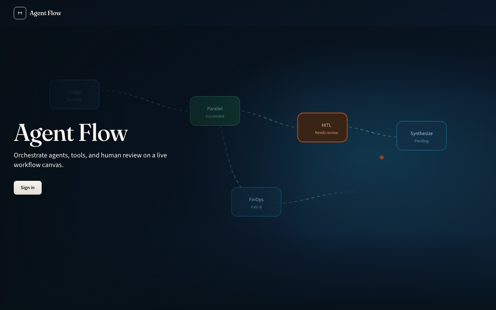
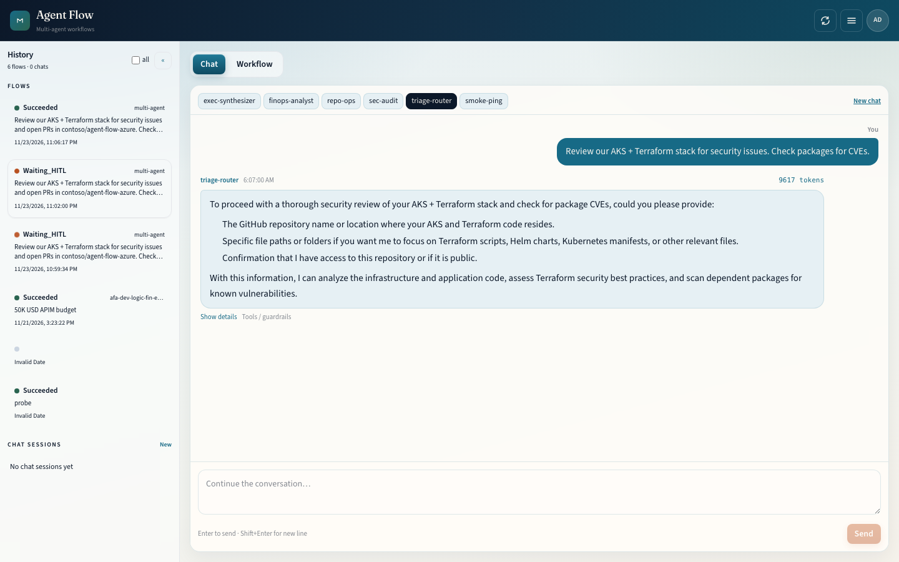
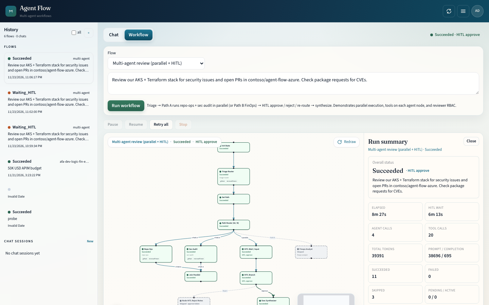
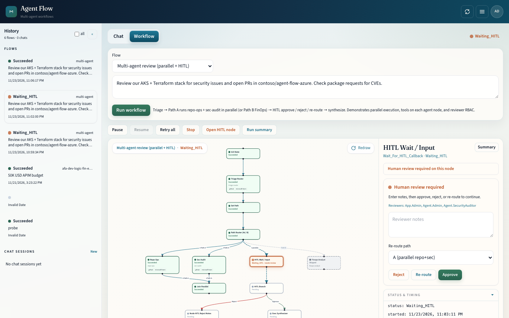

# agent-flow-azure

Production-oriented multi-agent platform on **Microsoft Foundry** (Copilot harness + agentic memory), **Azure API Management**, **Logic Apps Consumption**, and **Azure Functions**, with **Keycloak** user login federated to **Microsoft Entra**.

No demo personas, no local agent simulation, no app-minted tokens. Service-to-service auth is **Managed Identity** only.

## Screenshots & demo

| Landing | Chat |
|:---:|:---:|
|  |  |

| Workflow canvas | Human-in-the-loop approval |
|:---:|:---:|
|  |  |

▶️ **[Watch the full demo](https://youtu.be/0E8yZyupPd0)** — ~4 min walkthrough of the architecture, the Azure services and their purposes, the actual deployment, and a live workflow run through the HITL approval gate.

## Design & architecture

| Topic | Reference |
|---|---|
| Design — constraints, declarative agent catalog, tools/MCP, RBAC design | [docs/spec.md §1–2, §5](docs/spec.md) |
| System architecture (diagrams overview) | [docs/spec.md §3](docs/spec.md#3-system-architecture-diagrams) |
| **Deployment architecture** diagram | [docs/spec.md §3.1](docs/spec.md#31-deployment-architecture-diagram) |
| Security architecture (sequence) diagram | [docs/spec.md §3.2](docs/spec.md#32-security-architecture) |
| **End-to-end workflow & dataflow** diagram | [docs/spec.md §3.3](docs/spec.md#33-end-to-end-multi-agent-workflow--data-flow-diagram) |
| Requirements & acceptance criteria | [docs/requirements.md](docs/requirements.md) · [docs/spec.md §10](docs/spec.md#10-implementation-acceptance-criteria-definition-of-done) |

## Azure services & their purposes

| Service | Tier / SKU | Purpose in `agent-flow-azure` |
|---|---|---|
| **Microsoft Foundry** (Hub + Project) | Standard, pay per token | Hosts declarative Prompt Agents, the Copilot Harness, Guardrails, and Toolboxes. Project `afa-agents` in `afa-dev-foundry-eus2-01`. |
| **Azure OpenAI model deployments** | Global Standard | Reasoning for agents: `model-router` with `gpt-4.1-mini` / `gpt-4.1` / `gpt-4o` and `text-embedding-3-small` for memory. |
| **Azure API Management** (AI Gateway) | Consumption | JWT validation + policy interceptor (RBAC, rate limits, Foundry Guardrails) for every agent/tool call. |
| **Azure API Center** | Free | Private registry for discovering `SKILL.md` skills and MCP endpoints at runtime. |
| **Azure Logic Apps** (Consumption) | Pay per action | Durable state-machine orchestrator: sequential, parallel, conditional paths, HITL gates, pause/resume, cancel, node replay. |
| **Azure Functions** (Y1) | Consumption | Deterministic tools (`cve-lookup`, `cost-estimator`, `validate-request`) and the custom `mcp-afa-audit-store` MCP server. |
| **Azure Cosmos DB** (NoSQL) | Free tier | Run state, per-node inputs/outputs/checkpoints, HITL tokens, and in-app `Agent.*` ACL. |
| **Azure Storage** | Standard LRS | Versioned `SKILL.md` bundles, workflow artifacts, and Logic Apps state. |
| **Azure Key Vault** | Standard | Secrets, API keys, connection strings — read only via Managed Identity. |
| **Microsoft Entra ID** | Free | App registrations, roles, Managed Identities and Entra Agent IDs; federated through Keycloak. |
| **App Insights + Log Analytics** | 30-day retention | End-to-end traces: UI → backend → agent → tool. |
| **Keycloak** (self-hosted, `:5750`) | Community | OIDC login for users, realm roles `App.Admin` / `App.User`, brokers Entra. |

## Security model

| Concern | Approach |
|--------|----------|
| User login | Keycloak OIDC (`:5750`) — realm roles `App.Admin` / `App.User` |
| Entra | Bootstrap script creates users + app roles when Graph allows; Keycloak brokers Entra |
| Agent ACL | `Agent.*` stored in Cosmos; **App.Admin** assigns in-app |
| APIM | validate-jwt (Keycloak JWKS) + ACL; MI to Foundry |
| Data plane | Cosmos / Storage / KV via Managed Identity |

## Quickstart

```bash
cp .env.example .env
# set AZURE_SUBSCRIPTION_ID, AZURE_TENANT_ID

./scripts/provision.sh
./scripts/install.sh
docker compose -f infra/keycloak/docker-compose.yml up -d
./scripts/bootstrap_users.sh
./scripts/start.sh
```

- UI: http://localhost:5748  
- API: http://localhost:5749/docs  
- Keycloak: http://localhost:5750  

### Bootstrap users (Keycloak realm)

| User | Password | Roles |
|------|----------|-------|
| `admin` | `ChangeMeAdmin1!` | `App.Admin`, `Agent.Admin` |
| `developer` | `ChangeMeUser1!` | `App.User`, `Agent.Developer` |
| `auditor` | `ChangeMeUser2!` | `App.User`, `Agent.SecurityAuditor` |

Admins add more users in Entra/Keycloak, then assign `Agent.*` under **Users & roles** in the app.

### APIM + local Keycloak

Azure APIM must fetch Keycloak JWKS. If Keycloak is only on localhost, set `KEYCLOAK_PUBLIC_URL` to a publicly reachable URL (tunnel/hosted) before `provision.sh`, or validate agent calls via the backend (which talks to APIM/Foundry with the user JWT).

## Features

- **Chat / flow** with timestamps, input/output, skill/MCP/tool chips
- **Learning** pane — Foundry agentic/procedural memory (agent, functionality, learning, date)
- **App Insights** — UI → backend → agent → tool traces (`APPLICATIONINSIGHTS_CONNECTION_STRING`)
- **Logic Apps Consumption** + Functions Y1 (cheapest plans)

## Flows catalog & Azure sync

The app lists flows from `workflows/catalog.json` (plus local `workflows/logic-app-standard/<id>/workflow.json`). Use the **Sync from Azure** button in the top bar to pull Foundry agents and Logic Apps from your resource group into the portal dynamically (definitions + trigger URLs cached under `.data/`). Tag Logic Apps with `flow_id` for stable IDs; otherwise the Azure resource name is used.

## Lifecycle

```bash
./scripts/verify_rbac.sh          # Keycloak ROPC → backend ACL
./scripts/stop.sh
./scripts/decommission.sh --yes
```

## BOM

Cost-optimised tiers: APIM Consumption, Functions Y1, Logic Apps Consumption, Cosmos Free Tier, Key Vault Standard, App Insights + LAW (30d), Foundry project with `model-router` + gpt-4.1-mini/gpt-4.1/gpt-4o pool. See [Azure services & their purposes](#azure-services--their-purposes) and [docs/spec.md §4](docs/spec.md#4-bill-of-materials-bom--free--low-cost-azure-stack).

**Setup:** fill secrets/keys per [setup.md](./setup.md), then `./scripts/provision.sh` → `./scripts/install.sh` → `./scripts/start.sh`.
