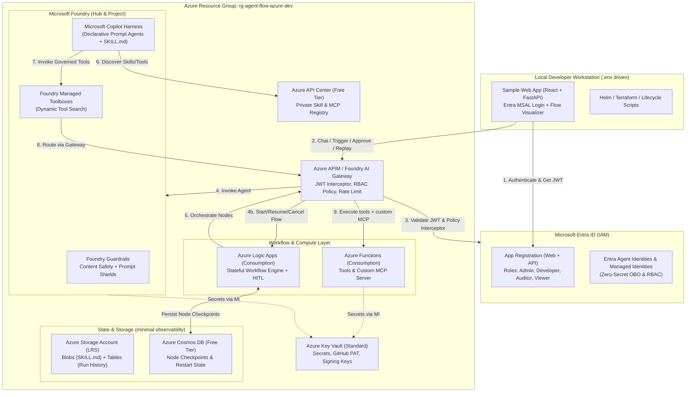
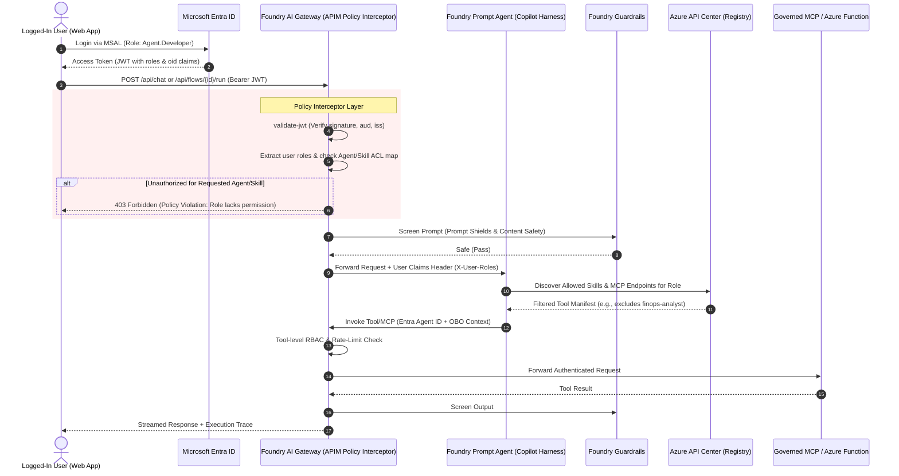
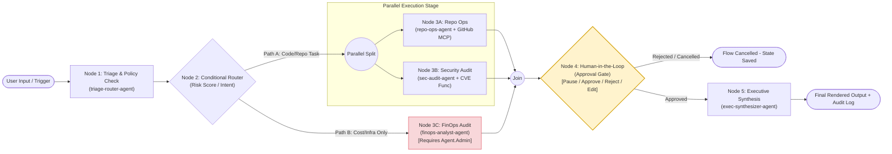

# Project Specification: `agent-flow-azure`

**Cloud-Native, Zero-Code Declarative Agentic Workflow Platform on Microsoft Foundry & Azure**

---

## 1. Executive Summary & Core Constraints

Build an end-to-end, cloud-native multi-agent workflow platform on **Microsoft Azure** using **Microsoft Foundry Agent Service**.

### Strict Architectural Mandates

1. **Zero-Code Agents:** Do **NOT** build custom-coded agents (no Python/C# LangGraph/Semantic Kernel agent loops). Every agent MUST be defined declaratively (YAML/JSON/REST/SDK definitions) as a **Foundry Prompt Agent** running on the managed **Microsoft Copilot Harness**, powered strictly by `SKILL.md` skills, **Foundry Toolboxes**, and **MCP (Model Context Protocol)** servers.
2. **Dynamic Discovery:** Agents must discover skills, REST tools, and MCP servers dynamically via **Foundry Toolboxes** (using Tool Search) and **Azure API Center (Private Skill & Tool Registry)** rather than hardcoded endpoint URLs.
3. **Gateway Governance & Interception:** All tool, skill, and MCP invocations must route through **Foundry AI Gateway / Azure API Management (APIM)** acting as an authorization interceptor enforcing Entra ID JWT validation, user-level RBAC claims, rate-limiting, and Foundry Guardrails (Content Safety + Prompt Shields).
4. **Stateful Workflow Orchestration:** Because native declarative workflows in Foundry retire on Dec 1, 2026, use **Azure Logic Apps (Consumption)** — the cheapest plan — as the durable state-machine orchestrator supporting sequential, parallel, conditional branching, Human-in-the-Loop (HITL) approval gates, pause/resume, cancellation, and node-level replay/restartability.
4b. **Identity:** Users authenticate via **Keycloak** (OIDC, port 5750) with `App.Admin` / `App.User`. Agent ACL (`Agent.*`) is assigned in-app by Admin and stored in Cosmos. Entra users are bootstrapped when Graph allows; Keycloak federates Entra. No demo personas or app-minted JWTs.
5. **Infrastructure as Code & Packaging:** All Azure resources must be provisioned/destroyed via **Terraform**. Containerized workloads (custom MCP servers, local/AKS companion APIs, web app) must be packaged with **Helm** and deployed via lifecycle shell scripts (`provision.sh`, `install.sh`, `start.sh`, `stop.sh`, `decommission.sh`).
6. **Configuration & Secrets:** 100% `.env`-driven configuration (`.env.example` committed, `.env` gitignored). Zero hardcoded secrets; all runtime credentials, tokens, and connection strings stored in **Azure Key Vault** and accessed via **Microsoft Entra Managed Identities** and **Entra Agent IDs**.
7. **Cost Optimization:** Use **Free / Consumption / Developer / F0** tiers wherever available across Azure resources.
8. **Naming & Tagging Convention:**
   - **Resource Naming Pattern:** `<project>-<env>-<service>-<region_short>-<suffix>` → e.g., `afa-dev-foundry-eus2-01` (prefix `afa` = `agent-flow-azure`).
   - **Mandatory Resource Tags:**

     ```hcl
     tags = {
       project     = "agent-flow-azure"
       environment = var.environment
       managed_by  = "terraform"
       owner       = "platform-engineering"
       cost_center = "ai-experiment"
     }
     ```

---

## 2. Open-Source Harness & `SKILL.md` Catalog

Agents use the **Microsoft Copilot Harness** built into Microsoft Foundry Prompt Agents (which natively manages the reasoning loop, context window, file sandbox, subagent delegation, and `SKILL.md` progressive disclosure).

### Curated Open-Source Skills to Import into Foundry & Azure API Center

Pull and adapt standard `SKILL.md` bundles from open-source repositories (`microsoft/skills`, `MicrosoftDocs/agent-skills`, `anthropics/skills`, and `agentskills.io`):

| Agent Name | Role & Persona | Open-Source `SKILL.md` Source | Bound Foundry Toolbox / MCPs | Access Role (`Entra App Role`) |
| :--- | :--- | :--- | :--- | :--- |
| **`triage-router-agent`** | Classifies intent, checks policy compliance, routes tasks | `microsoft/skills` → `cloud-solution-architect` + custom `intent-classifier/SKILL.md` | Azure Function (`validate-request`), API Center Registry lookup | `Agent.User` (All authenticated roles) |
| **`repo-ops-agent`** | Audits repos, drafts GitHub issues, reviews PR diffs | `microsoft/skills` → `github-issue-creator` & `mcp-builder` | **GitHub Official MCP Server** (via AI Gateway), Azure Function (`repo-metrics`) | `Agent.Developer`, `Agent.Admin` |
| **`sec-audit-agent`** | Scans configs/code for secrets, IAM flaws, & CVEs | `anthropics/skills` → `security-review` / `OWASP-audit` | Azure Function (`cve-lookup`), Microsoft Learn MCP | `Agent.SecurityAuditor`, `Agent.Admin` |
| **`finops-analyst-agent`** | Analyzes Azure SKU costs, tags, and optimization | `MicrosoftDocs/agent-skills` → `azure-cost-optimization` & `terraform-best-practices` | Azure Function (`cost-estimator`), Storage Table Query MCP | `Agent.Admin` **ONLY** |
| **`exec-synthesizer-agent`** | Compiles parallel branch outputs into executive briefs | `devblogs/foundry` → `research-brief/SKILL.md` | Foundry Code Interpreter (Charting/Markdown), Blob Artifact Writer | `Agent.User` (Output filtered by role) |

### Custom MCP Servers & Azure Function Tools

1. **Azure Functions (Python/Node — Consumption Plan Y1):**
   - `fn-afa-validate-request`: Validates payload schema and checks user Entra claims.
   - `fn-afa-cve-lookup`: Queries NVD/OSV vulnerability APIs for package security audits.
   - `fn-afa-cost-estimator`: Calculates estimated monthly Azure resource run-rate.
2. **MCP Servers (Hosted on Azure Functions — no ACA Environment):**
   - **Public MCP 1:** GitHub MCP Server (`api.githubcopilot.com/mcp/` or self-hosted container) routed through AI Gateway.
   - **Public MCP 2:** Microsoft Learn Docs MCP Server (`https://learn.microsoft.com/api/mcp`) for live Azure documentation grounding.
   - **Custom MCP (Functions):** `mcp-afa-audit-store` — Exposes tools (`list_runs`, `get_node_state`, `save_artifact`) on the Consumption Function App (Managed Identity → Cosmos/Table). ACA is **not** used: every Container App requires a Container Apps Environment (slow first create) and typically a Log Analytics workspace (costly).

---

## 3. System Architecture Diagrams

### 3.1 Deployment Architecture Diagram



### 3.2 Security Architecture



### 3.3 End-to-End Multi-Agent Workflow & Data Flow Diagram



---

## 4. Bill of Materials (BOM) — Free & Low-Cost Azure Stack

| # | Azure Service / Component | SKU / Pricing Tier | Free Tier / Cost Strategy | Purpose in agent-flow-azure |
| --- | --- | --- | --- | --- |
| 1 | Microsoft Foundry (Hub & Project) | Standard (Pay-as-you-go tokens) | $0 platform fee for Prompt Agents; pay only per token used | Hosts declarative Prompt Agents, Copilot Harness, Guardrails, and Toolboxes |
| 2 | Azure OpenAI / Model Deployments | Global Standard (`gpt-4o-mini` / `gpt-4.1-mini`) | Low-cost per-token inference | Reasoning engine for declarative agents and harness subagents |
| 3 | Azure API Management (AI Gateway) | Consumption Tier | First 1,000,000 calls/month FREE | Acts as the AI Gateway & Policy Interceptor for JWT/RBAC enforcement |
| 4 | Azure API Center | Free Tier | Free up to 100 APIs/Skills | Enterprise Registry for discovering `SKILL.md` catalogs and MCP endpoints |
| 5 | Azure Logic Apps (Consumption) | Consumption (pay-per-action) | Cheapest hosting — no WS1 plan; disable via `stop.sh` | Orchestrates sequential, parallel, conditional, HITL, pause/cancel, and node replay |
| 6 | Azure Functions | Consumption Plan (Y1) | 1,000,000 executions & 400,000 GB-s FREE/mo | Hosts deterministic tools (`cve-lookup`, `cost-estimator`) and custom MCP server |
| 7 | Azure Cosmos DB (NoSQL) | Free Tier (1000 RU/s, 25 GB) | Lifetime Free Tier (1 per subscription) | Stores workflow run state, per-node inputs/outputs, checkpoints, and HITL tokens |
| 8 | Azure Storage Account | Standard LRS (StorageV2) | ~$0.02/GB (pennies/month) | Hosts versioned `SKILL.md` bundles, workflow artifacts, and Logic Apps state |
| 9 | Azure Key Vault | Standard | ~$0.03 per 10,000 transactions | Stores secrets, API keys, and connection strings; accessed via Managed Identity |
| 10 | Microsoft Entra ID | Free Tier | Included with Azure subscription | Provides App Registrations, User Roles, Managed Identities, and Entra Agent IDs |
| — | ~~ACA / Log Analytics / App Insights~~ | — | **Not provisioned by default** | ACA requires a slow Environment + usually LAW; logging ingestion skipped for cost |

---

## 5. RBAC, Policy Interception & Dynamic Discovery Design

### 5.1 App roles + Agent ACL

| Role | Source | Purpose |
| :--- | :--- | :--- |
| `App.Admin` | Keycloak / Entra (required) | Platform admin; manages Agent.* ACL in-app |
| `App.User` | Keycloak / Entra (required) | Standard signed-in user |
| `Agent.Admin` | Cosmos (in-app) or Keycloak | Full agents, skills, MCPs, HITL |
| `Agent.Developer` | Cosmos / Keycloak | triage, repo-ops, synthesizer |
| `Agent.SecurityAuditor` | Cosmos / Keycloak | triage, sec-audit, synthesizer, HITL |
| `Agent.Viewer` | Cosmos / Keycloak | triage + synthesizer only |

Users are created by `scripts/bootstrap_users.sh` (Entra when possible, else Keycloak-native). Admins add more users in Entra/Keycloak and assign `Agent.*` in the app. No demo personas or app-minted JWTs.

### 5.2 Gateway Policy Interceptor (`infra/apim/policies/agent-interceptor.xml`)

Implement an APIM inbound policy that:

1. Validates the Keycloak Bearer JWT (`<validate-jwt>` against realm openid-config).
2. Requires `App.Admin` or `App.User`; enforces Agent.* ACL for agent routes.
3. Blocks unauthorized requests at the gateway edge (`403 Forbidden`) with a structured JSON reason before tokens are spent on Foundry.
4. Injects `X-User-Id`, `X-User-Roles`, and `X-Correlation-Id` headers downstream to Foundry and Logic Apps.
5. Authenticates to Foundry with Managed Identity (no keys).

---

## 6. Sample Web App Requirements (`/webapp`)

Build a clean, modern React (Vite + Tailwind CSS) + FastAPI (Python) local web application (`http://localhost:5748` frontend, `http://localhost:5749` backend proxy):

### Authentication

- Keycloak OIDC login/logout (no persona switcher). Top bar shows name, `App.*` roles, Permissions drawer, Learning pane, and Admin Users & roles (App.Admin only).
- Chat/history/inspector show timestamps, input/output, and skill/agent/MCP/tool chips. App Insights correlates UI → backend → agent → tool.

### Dual Execution Modes

- **Direct Agent Chat:** Select a Foundry Prompt Agent (locked agents return `403`). Responses include skill/MCP/tool traces and feed the Learning pane (Foundry agentic memory).
- **Agentic Workflow Execution:** Trigger the multi-stage Logic App workflow with custom input parameters.

### Interactive Visual Flow DAG & Controls

Render the workflow graph (using React Flow) showing real-time node statuses (`Pending`, `Running`, `Waiting_HITL`, `Succeeded`, `Failed`, `Skipped`, `Cancelled`).

Clicking any node opens an Inspector Drawer displaying:

- Discovered `SKILL.md` & MCP tools used by that node
- Exact Input JSON & Output Markdown/JSON
- Gateway Policy & Guardrail audit status

**Flow Controls:**

- **Human-in-the-Loop (HITL) Modal:** When paused at Node 4, allow an authorized user (`Agent.Admin` or `Agent.SecurityAuditor`) to Approve, Reject, or Inject Reviewer Notes to resume the Logic App callback URL.
- Pause / Resume active run.
- Cancel running workflow.
- **Restart from Node (Replay):** On any failed or completed node, click "Restart from this Node" to clone prior upstream state from Cosmos DB and re-execute the workflow starting cleanly at that node.

### User-Specific Execution History

Left sidebar listing past agent chats and workflow runs scoped strictly to the logged-in user's Entra `oid` (Admins have an optional toggle to view all users' runs). Clicking any historical run restores the full DAG state, node outputs, and chat transcript.

---

## 7. Repository & Directory Structure

```text
agent-flow-azure/
├── .env.example                    # Complete template of all required environment variables
├── .gitignore
├── README.md                       # Quickstart, architecture overview, and troubleshooting
├── spec.md                         # This specification
├── scripts/
│   ├── _common.sh                  # Shared .env loader, Azure CLI checks, naming helpers
│   ├── provision.sh                # Runs Terraform init/plan/apply + registers Entra App Roles
│   ├── install.sh                  # Uploads SKILL.md to Foundry/APIC, deploys Functions & Helm charts
│   ├── start.sh                    # Starts stopped Azure compute (Logic App/ACA) + local Web App
│   ├── stop.sh                     # Stops billable compute cleanly while preserving state
│   └── decommission.sh             # Tears down Helm releases, purges Key Vault, runs terraform destroy
├── infra/
│   ├── terraform/
│   │   ├── main.tf
│   │   ├── variables.tf
│   │   ├── outputs.tf              # Writes dynamic endpoints/IDs back to .env.azure.outputs
│   │   ├── entra_iam.tf            # App Registrations, App Roles, Managed Identities, RBAC
│   │   ├── foundry.tf              # Microsoft Foundry Hub, Project, Model Deployments, Guardrails
│   │   ├── gateway_registry.tf     # APIM (AI Gateway) + Policies + Azure API Center
│   │   ├── workflow_compute.tf     # Logic Apps Consumption, Function App (Y1)
│   │   └── data_security.tf        # Key Vault, Cosmos DB Free Tier, Storage Account, App Insights
│   ├── apim/
│   │   └── policies/
│   │       └── agent-interceptor.xml
│   └── helm/
│       └── agent-flow-mcp/         # Helm chart for custom MCP server & backend connector
│           ├── Chart.yaml
│           ├── values.yaml
│           └── templates/
├── agents/
│   ├── skills/                     # Open-source & custom SKILL.md bundles
│   │   ├── intent-classifier/SKILL.md
│   │   ├── github-issue-creator/SKILL.md
│   │   ├── owasp-security-audit/SKILL.md
│   │   ├── azure-finops-advisor/SKILL.md
│   │   └── research-brief/SKILL.md
│   ├── definitions/                # Declarative Foundry Prompt Agent YAML/JSON manifests
│   │   ├── triage-router-agent.yaml
│   │   ├── repo-ops-agent.yaml
│   │   ├── sec-audit-agent.yaml
│   │   ├── finops-analyst-agent.yaml
│   │   └── exec-synthesizer-agent.yaml
│   └── registry/
│       └── register_catalog.py     # Declarative script syncing skills, toolboxes & MCPs to Foundry + APIC
├── tools/
│   ├── azure-functions/            # Python v2 Azure Functions (Tools + MCP triggers)
│   │   ├── function_app.py
│   │   ├── host.json
│   │   └── requirements.txt
│   └── custom-mcp-server/          # FastMCP Python server packaged via Helm
│       ├── server.py
│       └── Dockerfile
├── workflows/
│   └── logic-app-standard/         # Consumption Logic App workflow definition (workflow.json)
│       ├── connections.json
│       └── multi-agent-flow/
│           └── workflow.json
└── webapp/
    ├── backend/                    # FastAPI gateway/orchestration facade
    │   ├── main.py
    │   ├── auth.py                 # Entra JWT validation + Dev Persona Token issuer
    │   └── requirements.txt
    └── frontend/                   # React + Vite + Tailwind + React Flow UI
        ├── package.json
        └── src/
```

---

## 8. Lifecycle Automation Scripts (`/scripts`)

All scripts must source `.env` via `scripts/_common.sh`, validate prerequisites (`az`, `terraform`, `helm`, `func`, `python3`, `node`), use `set -euo pipefail`, and support idempotent re-runs:

### `./scripts/provision.sh`

- Validates `az account show` and `.env` variables.
- Runs `terraform -chdir=infra/terraform init && apply -auto-approve`.
- Captures Terraform outputs (Foundry endpoint, APIM gateway URL, API Center ID, Key Vault URI, Cosmos endpoint, Entra Client IDs) and writes them to `.env.generated`.

### `./scripts/install.sh`

- Seeds external secrets (`GITHUB_MCP_PAT`, `NVD_API_KEY`) into Azure Key Vault only.
- Publishes Azure Functions; runs `register_catalog.py` (skills, API Center, Foundry agents + memory store); deploys Logic Apps Consumption workflow.

### `./scripts/bootstrap_users.sh`

- Creates Entra users + `App.*` / `Agent.*` app roles when Graph allows; ensures Keycloak realm users as fallback.

### `./scripts/start.sh`

- Starts Keycloak (`:5750`) if needed, then FastAPI (`:5749`) and React (`:5748`).

### `./scripts/stop.sh`

- Gracefully stops local frontend/backend processes.
- Scales down/stops billable Azure compute (Logic Apps Consumption disable, Function App stop) to keep idle Azure spend near $0 without deleting state or resources.

### `./scripts/decommission.sh`

- Prompts for confirmation (`--yes` flag to bypass).
- Uninstalls Helm releases (`helm uninstall`).
- Runs `terraform -chdir=infra/terraform destroy -auto-approve`.
- Purges soft-deleted Azure Key Vault and APIM instances so resource names can be cleanly reused.

---

## 9. `.env.example` Schema

```bash
# --- Core Project & Naming ---
PROJECT_NAME=agent-flow-azure
PROJECT_SHORT=afa
ENVIRONMENT=dev
AZURE_SUBSCRIPTION_ID=
AZURE_TENANT_ID=
AZURE_LOCATION=eastus2
AZURE_LOCATION_SHORT=eus2

# --- Model & Foundry Settings ---
FOUNDRY_MODEL_NAME=gpt-4o-mini
FOUNDRY_MODEL_VERSION=2024-07-18
FOUNDRY_HARNESS_TYPE=copilot
ENABLE_CONTENT_SAFETY=true
ENABLE_PROMPT_SHIELDS=true

# --- External MCP & Tool Secrets (Seeded into Azure Key Vault by install.sh) ---
GITHUB_MCP_PAT=
NVD_API_KEY=

# --- Web + Keycloak ---
WEBAPP_FRONTEND_PORT=5748
WEBAPP_BACKEND_PORT=5749
KEYCLOAK_URL=http://localhost:5750
KEYCLOAK_REALM=agent-flow
KEYCLOAK_CLIENT_ID=afa-web
KEYCLOAK_API_AUDIENCE=afa-api
ENTRA_REDIRECT_URI=http://localhost:5748/
```

---

## 10. Implementation Acceptance Criteria (Definition of Done)

Before concluding task execution, verify every item below:

- [ ] **Zero-Code Agents Verified:** All 5 agents are created strictly as declarative Foundry Prompt Agents using the Copilot harness, `SKILL.md` files, and Foundry Toolboxes/MCPs — no custom agent orchestration code exists in `agents/`.
- [ ] **Registry Discovery Verified:** Agents resolve tool/MCP endpoints from Azure API Center / Foundry Toolbox dynamically.
- [ ] **RBAC Verified:** `scripts/verify_rbac.sh` proves Keycloak `developer` gets `403` on `finops-analyst-agent` while `admin` succeeds.
- [ ] **Workflow Controls Verified:** Web app successfully demonstrates parallel execution (repo-ops + sec-audit), pauses at the HITL node, resumes on approval, supports cancel, and successfully restarts a failed workflow from a mid-flow node using Cosmos DB checkpoint state.
- [ ] **Lifecycle Scripts Verified:** `provision.sh`, `install.sh`, `start.sh`, `stop.sh`, and `decommission.sh` pass shellcheck and `--dry-run` / syntax validation with zero hardcoded secrets.
